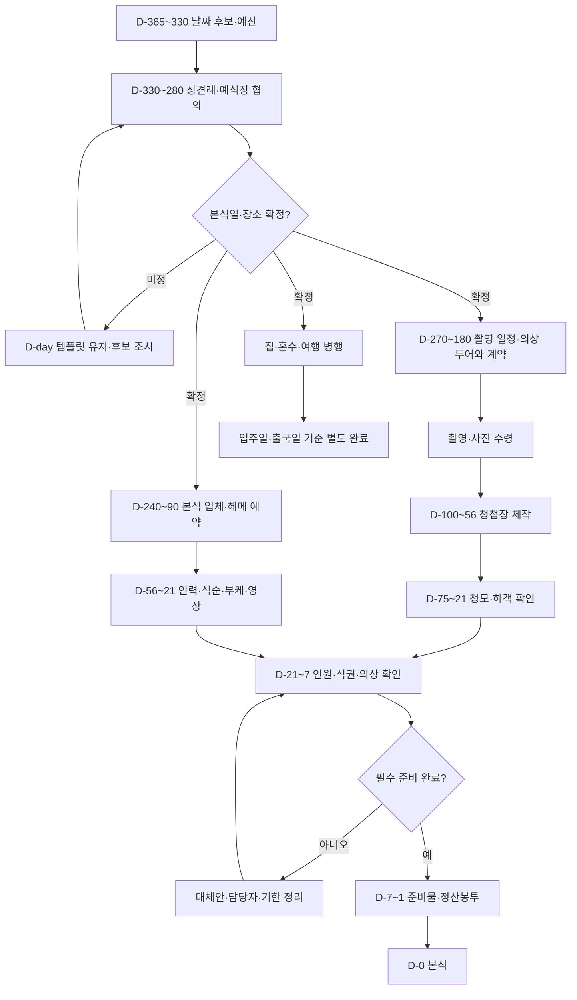
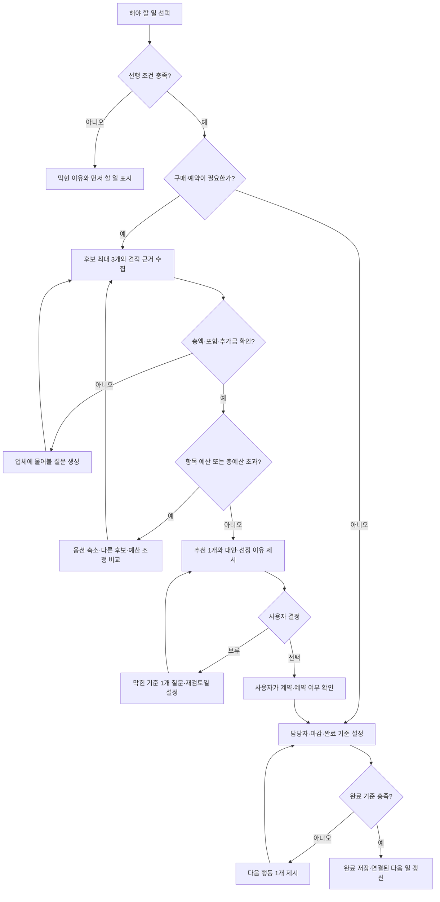

# 식장까지 업고 튀어 — D-day 역산 플로우
원본: 조원 개인 Notion (링크는 개인 자료라 지움)
사용자 지시에 따라 원본의 임의 날짜를 스케줄에서 제외했다. 업무·분류·상태·예산은 유지한다. 아래 상대 일정과 의존 관계는 새로 제안한 편집 가능한 기본값이며, 업체 납기나 예약 가능성을 보장하지 않는다. 원본 Notion은 변경하지 않았다.

## 전체 흐름

집·여행 완료는 본식의 필수 선행 조건이 아니다. 사진 없는 청첩장은 사진 수령 없이 제작 가능하다. 원본에 없는 촬영 실행·사진 수령·본식은 제안 마일스톤으로 구분한다.

## 원본 56개 업무의 상대 일정
시작=착수 권장일, 마감=완료 목표일. 하나만 표시할 때는 마감을 사용한다.
| ID | 분류 | 할 일 | 시작 | 마감 |
|---|---|---|---|---|
| T01 | 상견례 | 날짜 잡기 | D-330 | D-300 |
| T02 | 상견례 | 장소 잡기 | D-330 | D-300 |
| T03 | 상견례 | 양가 선물 정하기 | D-300 | D-280 |
| T04 | 웨딩 스케치 | 날짜 후보 정하기 | D-365 | D-330 |
| T05 | 웨딩 스케치 | 예산 대략 정하기 | D-365 | D-330 |
| T06 | 웨딩 스케치 | 웨딩 전용 카드 발급 | D-330 | D-300 |
| T07 | 홀 계약 | 예식장 날짜 전달 및 예산 받기 | D-330 | D-300 |
| T08 | 스드메 계약 | 촬영 날짜 확정 | D-270 | D-240 |
| T09 | 스드메 계약 | 드레스 계약 | D-210 | D-180 |
| T10 | 스드메 계약 | 예복 계약 | D-210 | D-180 |
| T11 | 스드메 계약 | 혼주 메이크업 예약 | D-180 | D-150 |
| T12 | 스드메 계약 | 본식 헤어/메이크업 예약 | D-240 | D-180 |
| T13 | 스드메 계약 | 웨딩링 계약 | D-240 | D-180 |
| T14 | 신혼집 | 신혼집 방향 결정 | D-240 | D-180 |
| T15 | 신혼여행 | 후보지 비교 | D-240 | D-210 |
| T16 | 본식 준비 | 본식 스냅 예약 | D-240 | D-180 |
| T17 | 본식 준비 | 본식 dvd 예약 | D-240 | D-180 |
| T18 | 본식 준비 | 아이폰 스냅 예약 | D-180 | D-150 |
| T19 | 본식 준비 | 뷔페 예약 | D-180 | D-150 |
| T20 | 본식 준비 | 꽃장식 예약 | D-180 | D-150 |
| T21 | 본식 준비 | 헬퍼 예약 | D-120 | D-90 |
| T22 | 스튜디오 촬영 | 스냅 시안 및 소품 준비 | D-150 | D-130 |
| T23 | 드레스&예복 | 드레스샵 투어 | D-240 | D-210 |
| T24 | 드레스&예복 | 예복 투어 | D-240 | D-210 |
| T25 | 신혼집 | 신혼집 임장하기 | D-180 | D-120 |
| T26 | 신혼집 | 혼수 리스트 작성 | D-120 | D-90 |
| T27 | 신혼여행 | 여행계획 | D-210 | D-180 |
| T28 | 신혼여행 | 항공편 예약 | D-210 | D-180 |
| T29 | 신혼여행 | 숙소 예약 | D-180 | D-150 |
| T30 | 청첩장 제작 | 회의 및 제작 | D-100 | D-80 |
| T31 | 청첩장 제작 | 청모 인원 짜보기 | D-100 | D-80 |
| T32 | 청첩장 제작 | 청모 진행 | D-75 | D-21 |
| T33 | 신혼집 | 혼수 구매 | D-60 | D-21 |
| T34 | 드레스&예복 | 드레스 가봉 | D-42 | D-21 |
| T35 | 드레스&예복 | 예복 가봉 | D-56 | D-28 |
| T36 | 본식 준비 | 가방순이 섭외 | D-56 | D-32 |
| T37 | 본식 준비 | 축의대 섭외 | D-56 | D-32 |
| T38 | 본식 준비 | 반주자 섭외 | D-56 | D-32 |
| T39 | 신혼집 | 신혼집 계약 및 이사준비 | D-120 | D-60 |
| T40 | 스드메 계약 | 혼주 한복 맞추기 | D-100 | D-60 |
| T41 | 스드메 계약 | 혼주 예복 구입 | D-100 | D-60 |
| T42 | 본식 준비 | 부케 준비 | D-56 | D-21 |
| T43 | 본식 준비 | 답례품 준비 | D-56 | D-21 |
| T44 | 본식 준비 | 하객 리스트 작성 (최종 인원 확인) | D-56 | D-14 |
| T45 | 본식 준비 | 식순 준비 | D-56 | D-21 |
| T46 | 본식 준비 | BGM 준비 (입장곡, 퇴장곡) | D-32 | D-14 |
| T47 | 본식 준비 | 모바일 청첩장 제작 | D-75 | D-56 |
| T48 | 본식 준비 | 성혼선언문? 혼인서약서? | D-32 | D-14 |
| T49 | 본식 준비 | 포토테이블 상의 | D-42 | D-21 |
| T50 | 본식 준비 | 식전영상 회의 및 제작 | D-56 | D-21 |
| T51 | 본식 준비 | 식권 준비 | D-21 | D-7 |
| T52 | 본식 준비 | 축의대 준비물 챙기기 | D-14 | D-3 |
| T53 | 본식 준비 | 헬퍼비 정산봉투 준비 | D-7 | D-1 |
| T54 | 본식 준비 | 주례비 정산봉투 준비 | D-7 | D-1 |
| T55 | 본식 준비 | 혼주 한복 체크 | D-21 | D-7 |
| T56 | 본식 준비 | 신랑 예복 체크 | D-21 | D-7 |

## 별도 기준일과 순서
- 본식일은 미정(null)으로 시작한다. D-day 템플릿은 본식일 없이도 표시한다.
- T03 양가 선물은 상견례일이 정해지면 상견례 21일 전 시작~7일 전 완료로 대체한다.
- T22 촬영 소품은 실제 촬영일이 정해지면 촬영 30일 전 시작~7일 전 완료로 대체한다.
- T33 혼수 구매는 입주일이 정해지면 입주 60일 전 시작~14일 전 주문·배송 일정 확인으로 대체한다. 배송 완료는 별도 관리한다.
- T28 항공은 출국 210~180일 전, T29 숙소는 출국 180~150일 전을 편집 가능한 기본값으로 제안한다. 여행지 조사와 계획도 출국일에 맞춰 조정할 수 있다.
- 위 기준일이 없으면 표의 본식 기준 배치는 ‘임시 일정’으로 표시한다.
- 의상은 투어→계약→가봉 순서를 제안했다. 촬영용/본식용 또는 패키지 선계약이면 사용자가 구분·수정한다.
- ‘촬영 날짜 확정’ 완료와 실제 촬영 완료는 별개다. 촬영일과 보정본 수령일을 따로 입력한다.
- 뷔페 예약은 예상 인원으로, 최종 수량·식권은 최종 인원으로 결정한다. 계약상 인원 통보일이 있으면 기본 D-14보다 우선한다.
- 주례비·성혼선언문·DVD·아이폰 스냅 등의 필수 여부는 사용자가 설정한다.

## 에이전트의 결정 지원



## 구현 프롬프트
이 문서 전체를 바이브코딩 도구에 입력한다.

한국어 결혼 준비 웹앱 ‘식장까지 업고 튀어’를 React + TypeScript로 만들어줘.
예산 관리, 견적 비교, 결정 부담 감소, 일정 완주가 목표다.
아래 JSON의 원본 56개 업무·상태·예산을 seed로 사용해줘.
originalStartDate/originalEndDate는 사용자가 임의로 넣은 과거 기록이므로 실제 일정 계산에 절대 사용하지 마.
startDaysBefore/dueDaysBefore로 본식 D-0에서 역산하고, 별도 기준일 override를 구현해줘.

화면은 오늘 할 일, 전체 타임라인, 견적 비교, 예산, 결정 도우미, 본식 체크로 구성해줘.
본식일 미정이면 D-56 등 상대 일정만 보여주고, 입력하면 달력 보기와 전환할 수 있게 해줘.
오늘 할 일은 최대 3개, 각각 선정 이유·다음 행동 1개를 보여줘.
업무 상세에서 기한·기준일·담당자·필수 여부·상태·원본 링크·완료 기준을 편집하게 해줘.
미정 정보가 있어도 진행 가능하게 하고 값을 임의로 채우지 마.

원본 상태 ‘시작 전/진행 중/완료’를 유지하고 보류·차단·지연은 별도 필드로 관리해줘.
선행 관계는 사용자 확인 후 활성화하고 확인된 hard 관계만 실행을 막아줘. 후보 조사는 허용해줘.
완료한 촬영 날짜 확정 업무를 촬영 실행·사진 수령 완료로 자동 전파하지 마.
예약 확정은 본식 날짜·장소 확인이 선행하고, 사진 포함 제작물만 사진 수령에 의존하게 해줘.
신혼집·여행은 본식 완료를 막지 않게 해줘.
추가 마일스톤(실제 촬영, 보정본 수령, 최종 업체 확인, 당일 진행표, 본식)은 origin=proposed로 구분하고 사용자 채택 후 표시해줘.

localStorage에 스키마 버전을 붙여 저장하고 새로고침 시 사용자 수정이 보존되게 해줘.
JSON 가져오기/내보내기와 sourceUrl 기준 중복 방지, 병합 미리보기를 제공해줘.
실제 Notion 동기화·업체 검색·AI가 연결된 것처럼 표시하지 마. MVP 추천은 명시적 규칙 기반으로 구현해줘.
한국어 UI, 원화, Asia/Seoul 날짜 기준, 모바일 우선으로 만들어줘.
문구는 “바가지는 막고, 고민은 줄이고, 식장까지 업고 뛴다.”
자동 계약·결제·업체 연락 없이 사용자에게 다음 행동과 문의 초안을 제공해줘.

## 세부 계산 규칙
### 일정
- 날짜 = 기준일 - daysBefore 달력 일수. D-56은 56, D-0은 0, D+7은 -7.
- startDaysBefore >= dueDaysBefore 검증. 날짜 단위로 계산하며 UTC 변환으로 하루가 밀리지 않게 한다.
- 기준일 없으면 실제 planStart/planDue=null. 상대 기한은 표시하되 지연으로 판정하지 않는다.
- 기준일 변경 시 미확정 작업에만 재계산 미리보기를 제시한다. fixedDate가 있는 확정 예약과 completedAt은 유지한다.
- hard 관계 일정이 충돌하면 자동으로 무한 연기하지 않고 영향 범위와 대체안을 보여준다. 순환 의존은 거부한다.
- 준비를 D-56에 시작했다면 지난 단계들을 ‘이미 완료/지금 진행/제외’로 확인한 뒤 압축 계획을 제안한다. 자동 완료 처리하지 않는다.
- 실제 마감이 있고 현지 오늘 이전이며 미완료일 때만 기한 경과로 표시한다.
- 선택 항목 제외 시 본식 필수 준비율 분모에서 제외한다.
### 비용
- 예산 null과 0원을 구분한다. 원본 950,000원은 작업 예산이며 실제 지출·총예산이 아니다.
- 집·여행 포함 범위, 예비비를 먼저 설정한다. 총예산 미정이면 초과 여부를 단정하지 않는다.
- 견적은 기본가, 필수 추가금, 선택 옵션, 세금 포함 여부, 근거, 확인일, 총액 완결성을 보관한다.
- 추가금 미확인 시 확정 총액 대신 확인된 최소금액을 표시한다.
- 작업 예상비용은 계약액 > 선택 견적 > 작업 예산 중 하나만 합산한다. 지급액은 비용에 더하지 않는다.
- 잔금 = 계약액 - 지급합계. 초과 지급은 확인 대상으로 표시한다.
- 실제 업체 가격을 만들거나 근거 없이 ‘바가지/최저가’로 판정하지 않는다.
### 결정
- 최대 3개 후보를 동일 조건으로 비교하고 추천 1개+대안+이유를 제시한다.
- 보류하면 막힌 기준 1개와 재검토일을 기록한다. 원래 업무 마감은 유지한다.
- 사용자 최종 선택 이후에도 실제 계약·예약 완료 확인을 별도로 받는다.

## 데이터 모델 확장
Task: seed 필드 + ownerIds, requiredForWedding, completionCriteria, dependencies[{taskId,type,confirmed}], fixedStart, fixedDue, completedAt, decisionStatus, nextReviewDate.
Project: weddingDate, familyMeetingDate, shootDate, moveInDate, departureDate, totalBudget, reserveBudget, budgetScope.
Quote: taskId, vendorName, basePrice, mandatoryExtras, optionalExtras, taxIncluded, totalPrice, completeness, evidence, checkedAt.
Contract: taskId, agreedTotal, quoteId. Payment: contractId, amount, paidAt.
별도 기준일 override는 적용 기준과 해당 startDaysBefore/dueDaysBefore를 Task에 저장한다.

## 수용 기준
- 원본 56개, 상태 시작 전 52/진행 중 3/완료 1, 예산 입력 1개 950,000원 유지.
- 원본 날짜는 스케줄에 사용되지 않음.
- 테스트 본식일 2027-05-22에서 D-56=2027-03-27, D-32=2027-04-20. 이 날짜는 테스트일 뿐 사용자 본식일로 저장하지 않음.
- 본식일 null이면 실제 날짜·지연 판단 없이 상대 일정 표시.
- 촬영일 입력 후 T22는 촬영일-30~-7 사용.
- 본식일 변경 시 확정 예약과 완료일 보존.
- 예산 100만/계약 90만/지급 30만이면 예상비용 90만, 잔금 60만.
- 재가져오기로 중복 생성되지 않고 새로고침 후 편집 보존.
- 순환 의존 거부, 선택 작업 제외 및 별도 입주/여행이 본식 완료를 막지 않음.

## 초기 데이터
```json
{
  "project": {
    "name": "식장까지 업고 튀어",
    "weddingDate": null,
    "totalBudget": null,
    "timezone": "Asia/Seoul"
  },
  "tasks": [
    {
      "id": "T01",
      "title": "날짜 잡기",
      "categories": [
        "상견례"
      ],
      "status": "시작 전",
      "budget": null,
      "sourceUrl": null,
      "origin": "source",
      "startDaysBefore": 330,
      "dueDaysBefore": 300,
      "anchor": "wedding",
      "scheduleOrigin": "proposed"
    },
    {
      "id": "T02",
      "title": "장소 잡기",
      "categories": [
        "상견례"
      ],
      "status": "시작 전",
      "budget": null,
      "sourceUrl": null,
      "origin": "source",
      "startDaysBefore": 330,
      "dueDaysBefore": 300,
      "anchor": "wedding",
      "scheduleOrigin": "proposed"
    },
    {
      "id": "T03",
      "title": "양가 선물 정하기",
      "categories": [
        "상견례"
      ],
      "status": "시작 전",
      "budget": null,
      "sourceUrl": null,
      "origin": "source",
      "startDaysBefore": 300,
      "dueDaysBefore": 280,
      "anchor": "wedding",
      "scheduleOrigin": "proposed"
    },
    {
      "id": "T04",
      "title": "날짜 후보 정하기",
      "categories": [
        "웨딩 스케치"
      ],
      "status": "진행 중",
      "budget": null,
      "sourceUrl": null,
      "origin": "source",
      "startDaysBefore": 365,
      "dueDaysBefore": 330,
      "anchor": "wedding",
      "scheduleOrigin": "proposed"
    },
    {
      "id": "T05",
      "title": "예산 대략 정하기",
      "categories": [
        "웨딩 스케치"
      ],
      "status": "진행 중",
      "budget": null,
      "sourceUrl": null,
      "origin": "source",
      "startDaysBefore": 365,
      "dueDaysBefore": 330,
      "anchor": "wedding",
      "scheduleOrigin": "proposed"
    },
    {
      "id": "T06",
      "title": "웨딩 전용 카드 발급",
      "categories": [
        "웨딩 스케치"
      ],
      "status": "시작 전",
      "budget": null,
      "sourceUrl": null,
      "origin": "source",
      "startDaysBefore": 330,
      "dueDaysBefore": 300,
      "anchor": "wedding",
      "scheduleOrigin": "proposed"
    },
    {
      "id": "T07",
      "title": "예식장 날짜 전달 및 예산 받기",
      "categories": [
        "홀 계약"
      ],
      "status": "시작 전",
      "budget": null,
      "sourceUrl": null,
      "origin": "source",
      "startDaysBefore": 330,
      "dueDaysBefore": 300,
      "anchor": "wedding",
      "scheduleOrigin": "proposed"
    },
    {
      "id": "T08",
      "title": "촬영 날짜 확정",
      "categories": [
        "스드메 계약"
      ],
      "status": "완료",
      "budget": 950000,
      "sourceUrl": null,
      "origin": "source",
      "startDaysBefore": 270,
      "dueDaysBefore": 240,
      "anchor": "wedding",
      "scheduleOrigin": "proposed"
    },
    {
      "id": "T09",
      "title": "드레스 계약",
      "categories": [
        "스드메 계약"
      ],
      "status": "시작 전",
      "budget": null,
      "sourceUrl": null,
      "origin": "source",
      "startDaysBefore": 210,
      "dueDaysBefore": 180,
      "anchor": "wedding",
      "scheduleOrigin": "proposed"
    },
    {
      "id": "T10",
      "title": "예복 계약",
      "categories": [
        "스드메 계약"
      ],
      "status": "시작 전",
      "budget": null,
      "sourceUrl": null,
      "origin": "source",
      "startDaysBefore": 210,
      "dueDaysBefore": 180,
      "anchor": "wedding",
      "scheduleOrigin": "proposed"
    },
    {
      "id": "T11",
      "title": "혼주 메이크업 예약",
      "categories": [
        "스드메 계약"
      ],
      "status": "시작 전",
      "budget": null,
      "sourceUrl": null,
      "origin": "source",
      "startDaysBefore": 180,
      "dueDaysBefore": 150,
      "anchor": "wedding",
      "scheduleOrigin": "proposed"
    },
    {
      "id": "T12",
      "title": "본식 헤어/메이크업 예약",
      "categories": [
        "스드메 계약"
      ],
      "status": "시작 전",
      "budget": null,
      "sourceUrl": null,
      "origin": "source",
      "startDaysBefore": 240,
      "dueDaysBefore": 180,
      "anchor": "wedding",
      "scheduleOrigin": "proposed"
    },
    {
      "id": "T13",
      "title": "웨딩링 계약",
      "categories": [
        "스드메 계약"
      ],
      "status": "진행 중",
      "budget": null,
      "sourceUrl": null,
      "origin": "source",
      "startDaysBefore": 240,
      "dueDaysBefore": 180,
      "anchor": "wedding",
      "scheduleOrigin": "proposed"
    },
    {
      "id": "T14",
      "title": "신혼집 방향 결정",
      "categories": [
        "신혼집"
      ],
      "status": "시작 전",
      "budget": null,
      "sourceUrl": null,
      "origin": "source",
      "startDaysBefore": 240,
      "dueDaysBefore": 180,
      "anchor": "wedding",
      "scheduleOrigin": "proposed"
    },
    {
      "id": "T15",
      "title": "후보지 비교",
      "categories": [
        "신혼여행"
      ],
      "status": "시작 전",
      "budget": null,
      "sourceUrl": null,
      "origin": "source",
      "startDaysBefore": 240,
      "dueDaysBefore": 210,
      "anchor": "wedding",
      "scheduleOrigin": "proposed"
    },
    {
      "id": "T16",
      "title": "본식 스냅 예약",
      "categories": [
        "본식 준비"
      ],
      "status": "시작 전",
      "budget": null,
      "sourceUrl": null,
      "origin": "source",
      "startDaysBefore": 240,
      "dueDaysBefore": 180,
      "anchor": "wedding",
      "scheduleOrigin": "proposed"
    },
    {
      "id": "T17",
      "title": "본식 dvd 예약",
      "categories": [
        "본식 준비"
      ],
      "status": "시작 전",
      "budget": null,
      "sourceUrl": null,
      "origin": "source",
      "startDaysBefore": 240,
      "dueDaysBefore": 180,
      "anchor": "wedding",
      "scheduleOrigin": "proposed"
    },
    {
      "id": "T18",
      "title": "아이폰 스냅 예약",
      "categories": [
        "본식 준비"
      ],
      "status": "시작 전",
      "budget": null,
      "sourceUrl": null,
      "origin": "source",
      "startDaysBefore": 180,
      "dueDaysBefore": 150,
      "anchor": "wedding",
      "scheduleOrigin": "proposed"
    },
    {
      "id": "T19",
      "title": "뷔페 예약",
      "categories": [
        "본식 준비"
      ],
      "status": "시작 전",
      "budget": null,
      "sourceUrl": null,
      "origin": "source",
      "startDaysBefore": 180,
      "dueDaysBefore": 150,
      "anchor": "wedding",
      "scheduleOrigin": "proposed"
    },
    {
      "id": "T20",
      "title": "꽃장식 예약",
      "categories": [
        "본식 준비"
      ],
      "status": "시작 전",
      "budget": null,
      "sourceUrl": null,
      "origin": "source",
      "startDaysBefore": 180,
      "dueDaysBefore": 150,
      "anchor": "wedding",
      "scheduleOrigin": "proposed"
    },
    {
      "id": "T21",
      "title": "헬퍼 예약",
      "categories": [
        "본식 준비"
      ],
      "status": "시작 전",
      "budget": null,
      "sourceUrl": null,
      "origin": "source",
      "startDaysBefore": 120,
      "dueDaysBefore": 90,
      "anchor": "wedding",
      "scheduleOrigin": "proposed"
    },
    {
      "id": "T22",
      "title": "스냅 시안 및 소품 준비",
      "categories": [
        "스튜디오 촬영"
      ],
      "status": "시작 전",
      "budget": null,
      "sourceUrl": null,
      "origin": "source",
      "startDaysBefore": 150,
      "dueDaysBefore": 130,
      "anchor": "wedding",
      "scheduleOrigin": "proposed"
    },
    {
      "id": "T23",
      "title": "드레스샵 투어",
      "categories": [
        "드레스&예복"
      ],
      "status": "시작 전",
      "budget": null,
      "sourceUrl": null,
      "origin": "source",
      "startDaysBefore": 240,
      "dueDaysBefore": 210,
      "anchor": "wedding",
      "scheduleOrigin": "proposed"
    },
    {
      "id": "T24",
      "title": "예복 투어",
      "categories": [
        "드레스&예복"
      ],
      "status": "시작 전",
      "budget": null,
      "sourceUrl": null,
      "origin": "source",
      "startDaysBefore": 240,
      "dueDaysBefore": 210,
      "anchor": "wedding",
      "scheduleOrigin": "proposed"
    },
    {
      "id": "T25",
      "title": "신혼집 임장하기",
      "categories": [
        "신혼집"
      ],
      "status": "시작 전",
      "budget": null,
      "sourceUrl": null,
      "origin": "source",
      "startDaysBefore": 180,
      "dueDaysBefore": 120,
      "anchor": "wedding",
      "scheduleOrigin": "proposed"
    },
    {
      "id": "T26",
      "title": "혼수 리스트 작성",
      "categories": [
        "신혼집"
      ],
      "status": "시작 전",
      "budget": null,
      "sourceUrl": null,
      "origin": "source",
      "startDaysBefore": 120,
      "dueDaysBefore": 90,
      "anchor": "wedding",
      "scheduleOrigin": "proposed"
    },
    {
      "id": "T27",
      "title": "여행계획",
      "categories": [
        "신혼여행"
      ],
      "status": "시작 전",
      "budget": null,
      "sourceUrl": null,
      "origin": "source",
      "startDaysBefore": 210,
      "dueDaysBefore": 180,
      "anchor": "wedding",
      "scheduleOrigin": "proposed"
    },
    {
      "id": "T28",
      "title": "항공편 예약",
      "categories": [
        "신혼여행"
      ],
      "status": "시작 전",
      "budget": null,
      "sourceUrl": null,
      "origin": "source",
      "startDaysBefore": 210,
      "dueDaysBefore": 180,
      "anchor": "wedding",
      "scheduleOrigin": "proposed"
    },
    {
      "id": "T29",
      "title": "숙소 예약",
      "categories": [
        "신혼여행"
      ],
      "status": "시작 전",
      "budget": null,
      "sourceUrl": null,
      "origin": "source",
      "startDaysBefore": 180,
      "dueDaysBefore": 150,
      "anchor": "wedding",
      "scheduleOrigin": "proposed"
    },
    {
      "id": "T30",
      "title": "회의 및 제작",
      "categories": [
        "청첩장 제작"
      ],
      "status": "시작 전",
      "budget": null,
      "sourceUrl": null,
      "origin": "source",
      "startDaysBefore": 100,
      "dueDaysBefore": 80,
      "anchor": "wedding",
      "scheduleOrigin": "proposed"
    },
    {
      "id": "T31",
      "title": "청모 인원 짜보기",
      "categories": [
        "청첩장 제작"
      ],
      "status": "시작 전",
      "budget": null,
      "sourceUrl": null,
      "origin": "source",
      "startDaysBefore": 100,
      "dueDaysBefore": 80,
      "anchor": "wedding",
      "scheduleOrigin": "proposed"
    },
    {
      "id": "T32",
      "title": "청모 진행",
      "categories": [
        "청첩장 제작"
      ],
      "status": "시작 전",
      "budget": null,
      "sourceUrl": null,
      "origin": "source",
      "startDaysBefore": 75,
      "dueDaysBefore": 21,
      "anchor": "wedding",
      "scheduleOrigin": "proposed"
    },
    {
      "id": "T33",
      "title": "혼수 구매",
      "categories": [
        "신혼집"
      ],
      "status": "시작 전",
      "budget": null,
      "sourceUrl": null,
      "origin": "source",
      "startDaysBefore": 60,
      "dueDaysBefore": 21,
      "anchor": "wedding",
      "scheduleOrigin": "proposed"
    },
    {
      "id": "T34",
      "title": "드레스 가봉",
      "categories": [
        "드레스&예복"
      ],
      "status": "시작 전",
      "budget": null,
      "sourceUrl": null,
      "origin": "source",
      "startDaysBefore": 42,
      "dueDaysBefore": 21,
      "anchor": "wedding",
      "scheduleOrigin": "proposed"
    },
    {
      "id": "T35",
      "title": "예복 가봉",
      "categories": [
        "드레스&예복"
      ],
      "status": "시작 전",
      "budget": null,
      "sourceUrl": null,
      "origin": "source",
      "startDaysBefore": 56,
      "dueDaysBefore": 28,
      "anchor": "wedding",
      "scheduleOrigin": "proposed"
    },
    {
      "id": "T36",
      "title": "가방순이 섭외",
      "categories": [
        "본식 준비"
      ],
      "status": "시작 전",
      "budget": null,
      "sourceUrl": null,
      "origin": "source",
      "startDaysBefore": 56,
      "dueDaysBefore": 32,
      "anchor": "wedding",
      "scheduleOrigin": "proposed"
    },
    {
      "id": "T37",
      "title": "축의대 섭외",
      "categories": [
        "본식 준비"
      ],
      "status": "시작 전",
      "budget": null,
      "sourceUrl": null,
      "origin": "source",
      "startDaysBefore": 56,
      "dueDaysBefore": 32,
      "anchor": "wedding",
      "scheduleOrigin": "proposed"
    },
    {
      "id": "T38",
      "title": "반주자 섭외",
      "categories": [
        "본식 준비"
      ],
      "status": "시작 전",
      "budget": null,
      "sourceUrl": null,
      "origin": "source",
      "startDaysBefore": 56,
      "dueDaysBefore": 32,
      "anchor": "wedding",
      "scheduleOrigin": "proposed"
    },
    {
      "id": "T39",
      "title": "신혼집 계약 및 이사준비",
      "categories": [
        "신혼집"
      ],
      "status": "시작 전",
      "budget": null,
      "sourceUrl": null,
      "origin": "source",
      "startDaysBefore": 120,
      "dueDaysBefore": 60,
      "anchor": "wedding",
      "scheduleOrigin": "proposed"
    },
    {
      "id": "T40",
      "title": "혼주 한복 맞추기",
      "categories": [
        "스드메 계약"
      ],
      "status": "시작 전",
      "budget": null,
      "sourceUrl": null,
      "origin": "source",
      "startDaysBefore": 100,
      "dueDaysBefore": 60,
      "anchor": "wedding",
      "scheduleOrigin": "proposed"
    },
    {
      "id": "T41",
      "title": "혼주 예복 구입",
      "categories": [
        "스드메 계약"
      ],
      "status": "시작 전",
      "budget": null,
      "sourceUrl": null,
      "origin": "source",
      "startDaysBefore": 100,
      "dueDaysBefore": 60,
      "anchor": "wedding",
      "scheduleOrigin": "proposed"
    },
    {
      "id": "T42",
      "title": "부케 준비",
      "categories": [
        "본식 준비"
      ],
      "status": "시작 전",
      "budget": null,
      "sourceUrl": null,
      "origin": "source",
      "startDaysBefore": 56,
      "dueDaysBefore": 21,
      "anchor": "wedding",
      "scheduleOrigin": "proposed"
    },
    {
      "id": "T43",
      "title": "답례품 준비",
      "categories": [
        "본식 준비"
      ],
      "status": "시작 전",
      "budget": null,
      "sourceUrl": null,
      "origin": "source",
      "startDaysBefore": 56,
      "dueDaysBefore": 21,
      "anchor": "wedding",
      "scheduleOrigin": "proposed"
    },
    {
      "id": "T44",
      "title": "하객 리스트 작성 (최종 인원 확인)",
      "categories": [
        "본식 준비"
      ],
      "status": "시작 전",
      "budget": null,
      "sourceUrl": null,
      "origin": "source",
      "startDaysBefore": 56,
      "dueDaysBefore": 14,
      "anchor": "wedding",
      "scheduleOrigin": "proposed"
    },
    {
      "id": "T45",
      "title": "식순 준비",
      "categories": [
        "본식 준비"
      ],
      "status": "시작 전",
      "budget": null,
      "sourceUrl": null,
      "origin": "source",
      "startDaysBefore": 56,
      "dueDaysBefore": 21,
      "anchor": "wedding",
      "scheduleOrigin": "proposed"
    },
    {
      "id": "T46",
      "title": "BGM 준비 (입장곡, 퇴장곡)",
      "categories": [
        "본식 준비"
      ],
      "status": "시작 전",
      "budget": null,
      "sourceUrl": null,
      "origin": "source",
      "startDaysBefore": 32,
      "dueDaysBefore": 14,
      "anchor": "wedding",
      "scheduleOrigin": "proposed"
    },
    {
      "id": "T47",
      "title": "모바일 청첩장 제작",
      "categories": [
        "본식 준비"
      ],
      "status": "시작 전",
      "budget": null,
      "sourceUrl": null,
      "origin": "source",
      "startDaysBefore": 75,
      "dueDaysBefore": 56,
      "anchor": "wedding",
      "scheduleOrigin": "proposed"
    },
    {
      "id": "T48",
      "title": "성혼선언문? 혼인서약서?",
      "categories": [
        "본식 준비"
      ],
      "status": "시작 전",
      "budget": null,
      "sourceUrl": null,
      "origin": "source",
      "startDaysBefore": 32,
      "dueDaysBefore": 14,
      "anchor": "wedding",
      "scheduleOrigin": "proposed"
    },
    {
      "id": "T49",
      "title": "포토테이블 상의",
      "categories": [
        "본식 준비"
      ],
      "status": "시작 전",
      "budget": null,
      "sourceUrl": null,
      "origin": "source",
      "startDaysBefore": 42,
      "dueDaysBefore": 21,
      "anchor": "wedding",
      "scheduleOrigin": "proposed"
    },
    {
      "id": "T50",
      "title": "식전영상 회의 및 제작",
      "categories": [
        "본식 준비"
      ],
      "status": "시작 전",
      "budget": null,
      "sourceUrl": null,
      "origin": "source",
      "startDaysBefore": 56,
      "dueDaysBefore": 21,
      "anchor": "wedding",
      "scheduleOrigin": "proposed"
    },
    {
      "id": "T51",
      "title": "식권 준비",
      "categories": [
        "본식 준비"
      ],
      "status": "시작 전",
      "budget": null,
      "sourceUrl": null,
      "origin": "source",
      "startDaysBefore": 21,
      "dueDaysBefore": 7,
      "anchor": "wedding",
      "scheduleOrigin": "proposed"
    },
    {
      "id": "T52",
      "title": "축의대 준비물 챙기기",
      "categories": [
        "본식 준비"
      ],
      "status": "시작 전",
      "budget": null,
      "sourceUrl": null,
      "origin": "source",
      "startDaysBefore": 14,
      "dueDaysBefore": 3,
      "anchor": "wedding",
      "scheduleOrigin": "proposed"
    },
    {
      "id": "T53",
      "title": "헬퍼비 정산봉투 준비",
      "categories": [
        "본식 준비"
      ],
      "status": "시작 전",
      "budget": null,
      "sourceUrl": null,
      "origin": "source",
      "startDaysBefore": 7,
      "dueDaysBefore": 1,
      "anchor": "wedding",
      "scheduleOrigin": "proposed"
    },
    {
      "id": "T54",
      "title": "주례비 정산봉투 준비",
      "categories": [
        "본식 준비"
      ],
      "status": "시작 전",
      "budget": null,
      "sourceUrl": null,
      "origin": "source",
      "startDaysBefore": 7,
      "dueDaysBefore": 1,
      "anchor": "wedding",
      "scheduleOrigin": "proposed"
    },
    {
      "id": "T55",
      "title": "혼주 한복 체크",
      "categories": [
        "본식 준비"
      ],
      "status": "시작 전",
      "budget": null,
      "sourceUrl": null,
      "origin": "source",
      "startDaysBefore": 21,
      "dueDaysBefore": 7,
      "anchor": "wedding",
      "scheduleOrigin": "proposed"
    },
    {
      "id": "T56",
      "title": "신랑 예복 체크",
      "categories": [
        "본식 준비"
      ],
      "status": "시작 전",
      "budget": null,
      "sourceUrl": null,
      "origin": "source",
      "startDaysBefore": 21,
      "dueDaysBefore": 7,
      "anchor": "wedding",
      "scheduleOrigin": "proposed"
    }
  ]
}
```

